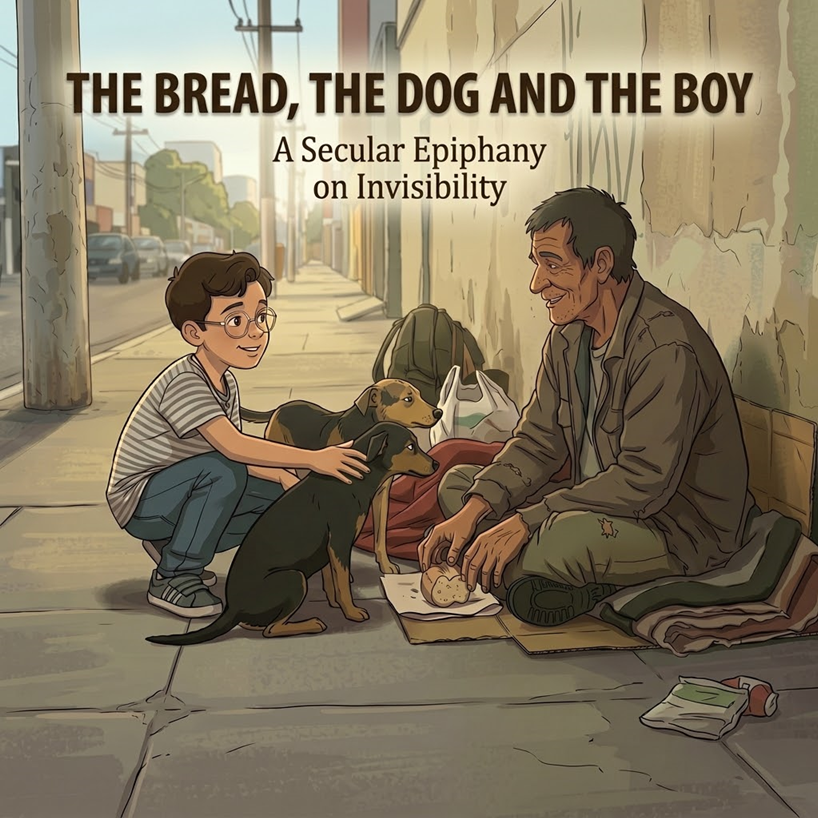

  <pre>

                              \\\\\\
                           \\\\\\\\\\\\
                          \\\\\\\\\\\\\\\
-------------,-|           |C>   // )\\\\|    .o88b. db   db  .d8b.  db    db  .d8b.  d888888b d888888b d88888b
           ,','|          /    || ,'/////|   d8P  Y8 88   88 d8' '8b 88    88 d8' '8b '~~88~~' '~~88~~' 88'  
---------,','  |         (,    ||   /////    8P      88ooo88 88ooo88 Y8    8P 88ooo88    88       88    88ooooo 
         ||    |          \\  ||||//''''|    8b      88~~~88 88~~~88 '8b  d8' 88~~~88    88       88    88~~~~~ 
         ||    |           |||||||     _|    Y8b  d8 88   88 88   88  '8bd8'  88   88    88       88    88.   
         ||    |______      ''''\____/ \      'Y88P' YP   YP YP   YP    YP    YP   YP    YP       YP    Y88888P
         ||    |     ,|         _/_____/ \
         ||  ,'    ,' |        /          |                 ___________________________________________
         ||,'    ,'   |       |         \  |              / \                                           \ 
_________|/    ,'     |      /           | |             |  | DevChavatte                                | 
_____________,'      ,',_____|      |    | |              \ |           chavatte@duck.com                | 
             |     ,','      |      |    | |                |                       chavatte.vercel.app  | 
             |   ,','    ____|_____/    /  |                |    ________________________________________|___
             | ,','  __/ |             /   |                |  /                                            /
_____________|','   ///_/-------------/   |                 \_/____________________________________________/ 
              |===========,'                                                                                  
			  
  </pre>

# The Bread🍞, the Dog🐕, and the Boy👦🏻

**Languages:** 🇺🇸 **English** · 🇧🇷 [Português](README.pt-BR.md)

A static, bilingual (Portuguese/English) web page with an integrated audio narration, developed to host a reflective chronicle about autism, otherness, and social invisibility.

## 📖 About the Project

This repository contains the source code for a literary and philosophical essay based on a true event. The story narrates the encounter of Vicente, a 10-year-old boy on the Autism Spectrum (ASD), with a homeless man and his dogs. 

The text explores how neurodivergence and the pure gaze of a child can break down the barriers of social invisibility, generating a profound reflection on empathy, the physiology of affection, and genuine charity.

## 🚀 Features and Technologies

The project was built with a focus on lightness, performance, and accessibility, using native web technologies without the need for external frameworks.

*   **Audio Narration (Audiobook):** Integrated native audio player with high-quality neural narration that syncs with the language toggle.
*   **HTML5 & CSS3:** Semantic structure and modern styling.
*   **Vanilla JavaScript:** Real-time language switching (PT-BR to EN) logic without page reloading.
*   **Elegant Dark Mode:** High-contrast color palette focused on visual comfort for prolonged reading.
*   **Smooth Transitions (Fade In/Out):** CSS animations manipulated via JavaScript for switching texts, cover images, and audio sources.
*   **SEO & Open Graph:** Fully configured metadata tags (dynamically updated via JS) to ensure perfect preview cards when sharing on LinkedIn, Twitter, Facebook, and WhatsApp.

## 👨‍💻 Author

**João Carlos Chavatte**

- Software Engineer and Vicente's father.
    
- [Portfolio](https://chavatte.vercel.app/)
    

_"The boy with ASD teaches us that true charity is not what you give to the other, but how you look at them."_