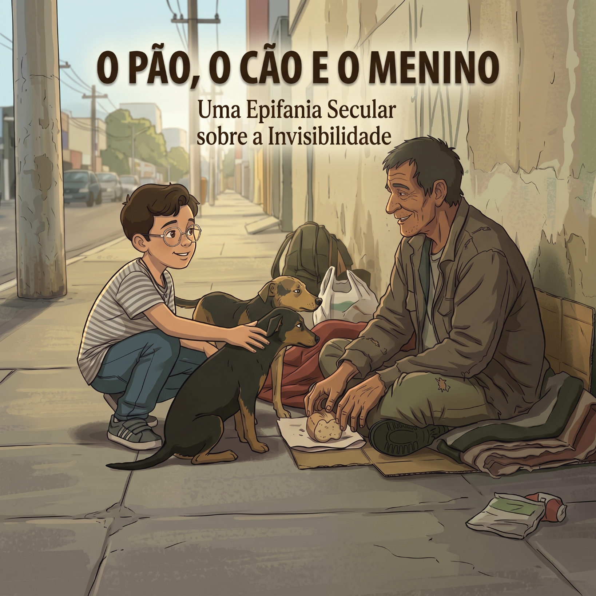

  <pre>

                              \\\\\\
                           \\\\\\\\\\\\
                          \\\\\\\\\\\\\\\
-------------,-|           |C>   // )\\\\|    .o88b. db   db  .d8b.  db    db  .d8b.  d888888b d888888b d88888b
           ,','|          /    || ,'/////|   d8P  Y8 88   88 d8' '8b 88    88 d8' '8b '~~88~~' '~~88~~' 88'  
---------,','  |         (,    ||   /////    8P      88ooo88 88ooo88 Y8    8P 88ooo88    88       88    88ooooo 
         ||    |          \\  ||||//''''|    8b      88~~~88 88~~~88 '8b  d8' 88~~~88    88       88    88~~~~~ 
         ||    |           |||||||     _|    Y8b  d8 88   88 88   88  '8bd8'  88   88    88       88    88.   
         ||    |______      ''''\____/ \      'Y88P' YP   YP YP   YP    YP    YP   YP    YP       YP    Y88888P
         ||    |     ,|         _/_____/ \
         ||  ,'    ,' |        /          |                 ___________________________________________
         ||,'    ,'   |       |         \  |              / \                                           \ 
_________|/    ,'     |      /           | |             |  | DevChavatte                                | 
_____________,'      ,',_____|      |    | |              \ |           chavatte@duck.com                | 
             |     ,','      |      |    | |                |                       chavatte.vercel.app  | 
             |   ,','    ____|_____/    /  |                |    ________________________________________|___
             | ,','  __/ |             /   |                |  /                                            /
_____________|','   ///_/-------------/   |                 \_/____________________________________________/ 
              |===========,'                                                                                  
			  
  </pre>

# O Pão🍞, o Cão🐕 e o Menino👦🏻

**Idiomas:**  🇧🇷 **Português** · 🇺🇸 [English](README.md)

Uma página web estática e bilíngue (Português/Inglês) com narração em áudio integrada, desenvolvida para abrigar uma crônica reflexiva sobre autismo, alteridade e invisibilidade social.

## 📖 Sobre o Projeto

Este repositório contém o código-fonte de um ensaio literário e filosófico baseado em um acontecimento real. A história narra o encontro de Vicente, um menino de 10 anos no Transtorno do Espectro Autista (TEA), com um homem em situação de rua e seus cachorros.

O texto explora como a neurodivergência e o olhar puro de uma criança podem desconstruir as barreiras da invisibilidade social, gerando uma reflexão profunda sobre empatia, fisiologia do afeto e caridade genuína.

## 🚀 Funcionalidades e Tecnologias

O projeto foi construído com foco em leveza, performance e acessibilidade, utilizando tecnologias web nativas sem a necessidade de frameworks externos.

- **Narração em Áudio (Audiobook):** Player de áudio nativo integrado, com narração neural de alta qualidade que acompanha a troca de idiomas.
    
- **HTML5 & CSS3:** Estrutura semântica e estilização moderna.
    
- **Vanilla JavaScript:** Lógica de troca de idioma (PT-BR para EN) em tempo real, sem recarregar a página.
    
- **Dark Mode Elegante:** Paleta de cores de alto contraste focada no conforto visual para leitura prolongada.
    
- **Transições Suaves (Fade In/Out):** Animações CSS manipuladas via JavaScript para a troca de textos, imagens de capa e faixas de áudio.
    
- **SEO & Open Graph:** Tags de metadados totalmente configuradas (dinamicamente via JS) para garantir cards de preview perfeitos em compartilhamentos no LinkedIn, Twitter, Facebook e WhatsApp.

## 👨‍💻 Autor

**João Carlos Chavatte**

- Engenheiro de Software e Pai do Vicente.
    
- [Portfólio](https://chavatte.vercel.app/)
    

_"O menino com TEA nos ensina que a verdadeira caridade não é o que você dá para o outro, mas como você olha para ele."_